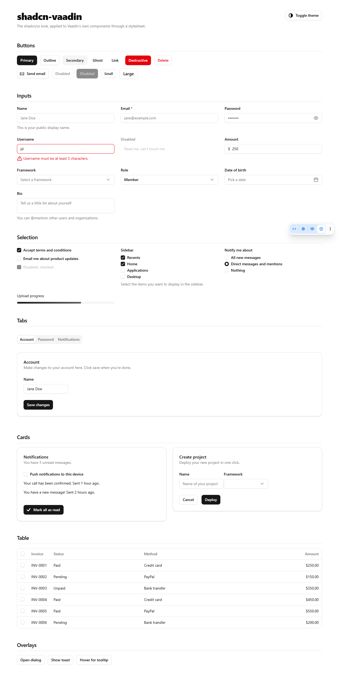
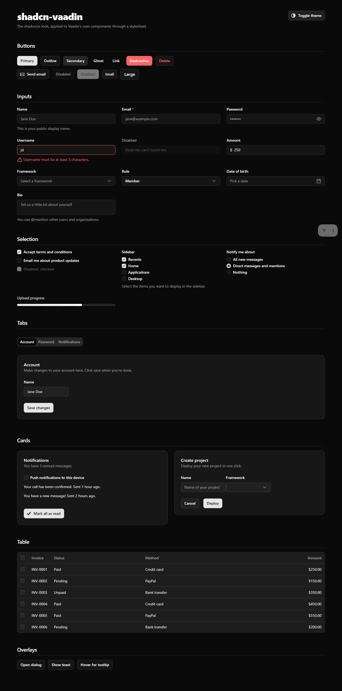
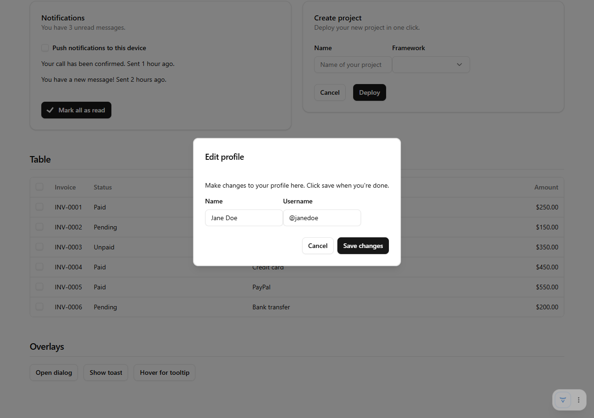
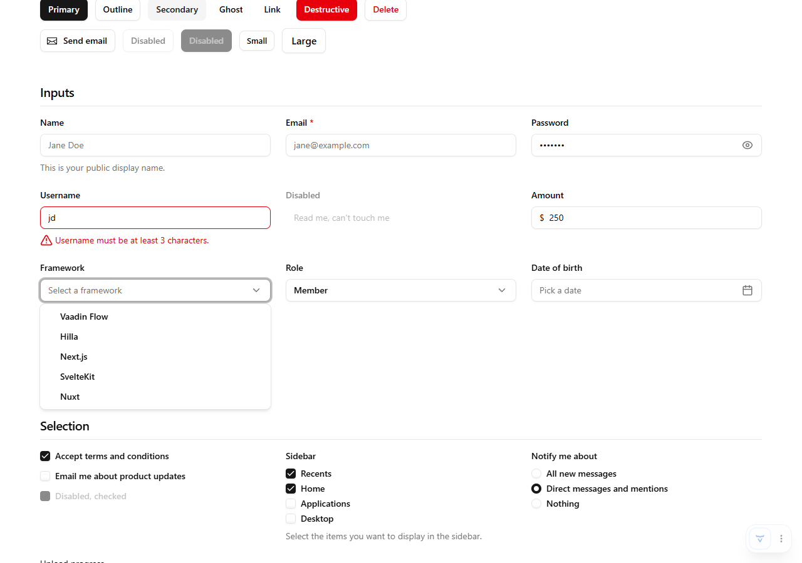

# shadcn-vaadin

The [shadcn/ui](https://ui.shadcn.com) look for [Vaadin](https://vaadin.com) 25, as a stylesheet.

shadcn/ui is a React library, and Vaadin Flow has no React render tree, so the components themselves
can't be reused. What *can* be reused is everything that makes shadcn recognisable: the neutral palette,
the radius scale, the hairline borders, the focus ring, the type scale and the component sizing. This
add-on ports those tokens and maps them onto Vaadin's base styles and the Aura theme. Every component
stays a real Vaadin component, so `Binder`, validation, keyboard handling, accessibility and TestBench
keep working unchanged.

Unofficial community port. Not affiliated with shadcn or Vaadin Ltd. Status: early, Vaadin 25.2+ only.

| Light | Dark |
|-------|------|
|  |  |

| Dialog | Combo box overlay |
|--------|-------------------|
|  |  |

## Install

```xml
<dependency>
    <groupId>io.github.ahnafeusa</groupId>
    <artifactId>shadcn-vaadin</artifactId>
    <version>0.1.0</version>
</dependency>
```

Then load it on your app shell, before your own stylesheets. Don't also load `Aura.STYLESHEET`; the
theme imports Aura itself.

```java
@StyleSheet(ShadcnTheme.STYLESHEET)
@StyleSheet("styles.css")
public class Application implements AppShellConfigurator {
}
```

## What maps to what

| shadcn                       | Vaadin                                              |
|------------------------------|-----------------------------------------------------|
| Button `default`             | `ButtonVariant.PRIMARY`                             |
| Button `outline`             | plain `Button`                                      |
| Button `secondary`           | `button.addClassName("shadcn-secondary")`           |
| Button `ghost`               | `ButtonVariant.TERTIARY`                            |
| Button `link`                | `button.addClassName("shadcn-link")`                |
| Button `destructive`         | `ButtonVariant.PRIMARY` + `ButtonVariant.ERROR`     |
| Button `sm` / `lg`           | `ButtonVariant.SMALL` / `ButtonVariant.LARGE`       |
| Input, Textarea, Select      | every Vaadin field (`TextField`, `ComboBox`, ...)   |
| Label, FormDescription, FormMessage | field label, helper text, error message      |
| Checkbox, RadioGroup         | `Checkbox`, `CheckboxGroup`, `RadioButtonGroup`     |
| Tabs                         | `Tabs`, `TabSheet`                                  |
| Card                         | `Card`                                              |
| Table                        | `Grid`                                              |
| Dialog                       | `Dialog`                                            |
| Sonner toast                 | `Notification`                                      |
| Tooltip                      | `Tooltip`                                           |
| Popover, DropdownMenu        | every overlay (combo box, date picker, menu bar)    |

Components without a row still render through Aura with the shadcn tokens applied, so they match in
colour, radius and type. They just haven't been tuned individually yet.

## Theming

Every colour is a `--shadcn-*-light` / `--shadcn-*-dark` pair on `html`. Override those; the unsuffixed
`--shadcn-*` properties resolve through `light-dark()` and are meant to be read, not set.

```css
html {
  --shadcn-primary-light: oklch(0.55 0.22 264);
  --shadcn-primary-foreground-light: white;
  --shadcn-radius: 0.5rem;
  --shadcn-font-sans: "Inter", ui-sans-serif, system-ui, sans-serif;
}
```

The token names follow shadcn's: `background`, `foreground`, `card`, `popover`, `primary`, `secondary`,
`muted`, `accent`, `destructive`, `border`, `input`, `ring`, plus `radius`, `font-sans`, `font-mono` and
the `shadow-xs` to `shadow-lg` scale. A theme generated for shadcn (for example from
[ui.shadcn.com/themes](https://ui.shadcn.com/themes)) can be transcribed by renaming `--primary` to
`--shadcn-primary-light` and the `.dark` value to `--shadcn-primary-dark`.

### Dark mode

Dark mode follows the CSS `color-scheme` property, the same as Aura:

```java
@ColorScheme(ColorScheme.Value.SYSTEM)          // on the AppShellConfigurator
UI.getCurrent().getPage().setColorScheme(ColorScheme.Value.DARK);   // at runtime
```

A `dark` class on `<html>`, the shadcn convention, is honoured too.

## Development

The demo app lives in `src/test` so it never ships in the JAR.

```bash
./mvnw                     # starts the demo on http://localhost:8080
./mvnw clean install       # builds the JAR
./mvnw clean install -Pdirectory   # also builds target/shadcn-vaadin-<version>.zip for vaadin.com/directory
```

### Screenshot tests

`screenshot-tests/` is a small Playwright project that renders the demo and compares it pixel-for-pixel
against baselines in `screenshot-tests/tests/demo.spec.ts-snapshots/`. CI runs it on every push, so a
Vaadin update or a CSS change that shifts anything shows up as a failing job with a diff report attached.

```bash
cd screenshot-tests
npm ci && npx playwright install chromium
npm test              # starts the demo itself if nothing is on :8080
npm run update        # rewrite the baselines after an intended change
```

Only the Linux baselines are committed, because text rendering differs per OS. Running locally on
Windows or macOS writes separate `-win32`/`-darwin` baselines that are gitignored. To refresh the
committed baselines after an intended visual change, run the CI workflow manually with
*update-snapshots* ticked, download the `screenshot-baselines` artifact and commit its contents.

Layout:

```
src/main/java/org/vaadin/addons/shadcn/ShadcnTheme.java   the STYLESHEET constant
src/main/resources/META-INF/resources/shadcn-vaadin/
  styles.css        master file; imports Aura, then everything below
  tokens.css        the shadcn tokens as --shadcn-* properties
  mapping.css       tokens -> --vaadin-* base properties and --aura-* properties
  typography.css    body, headings, links, code
  components/       one file per component that needs properties of its own
src/test/java/.../demo/                                    the kitchen-sink demo
screenshot-tests/                                          Playwright visual regression tests
```

## License

MIT. The design tokens are ported from shadcn/ui (MIT, Copyright (c) 2023 shadcn); see
[THIRD-PARTY-NOTICES.md](THIRD-PARTY-NOTICES.md).
